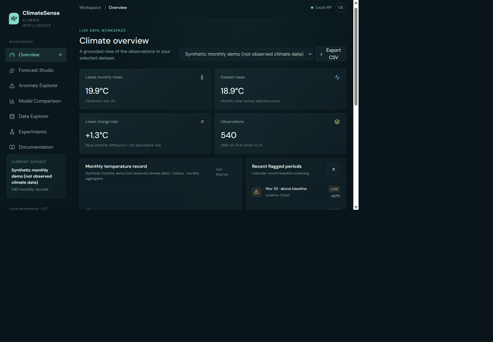
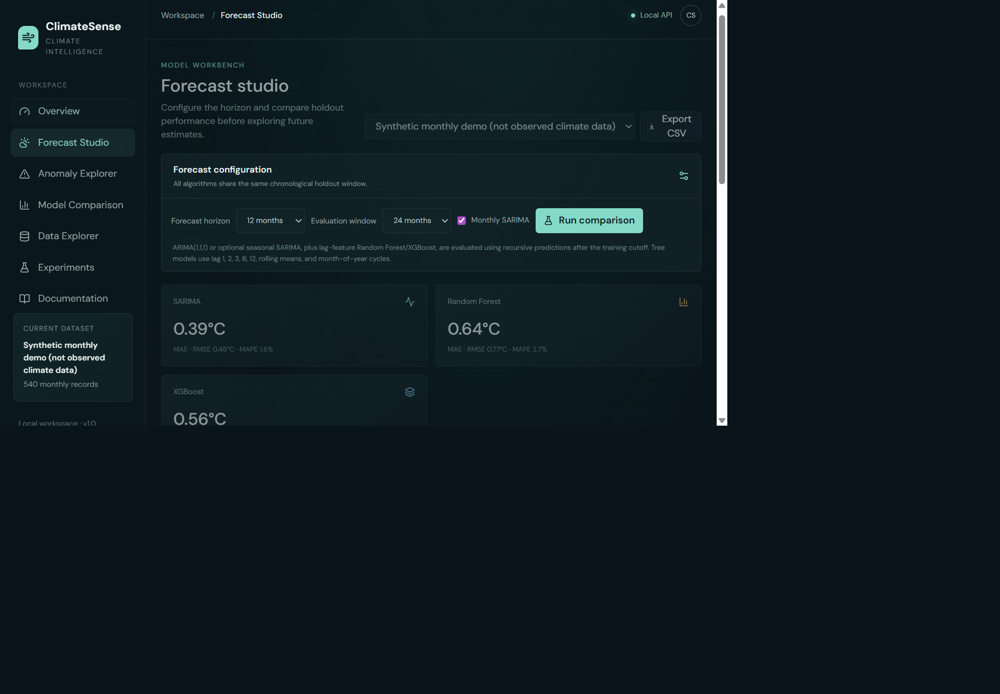
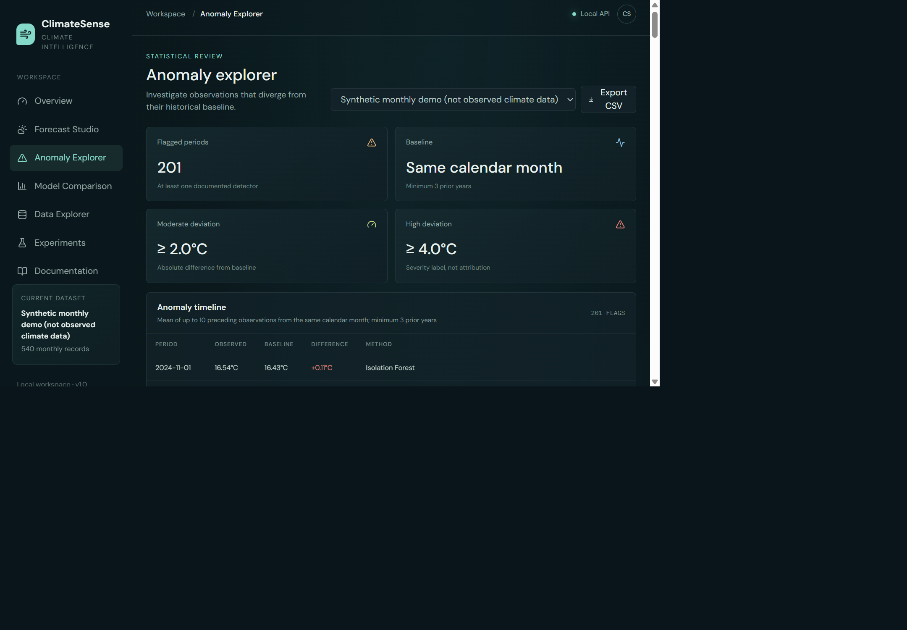
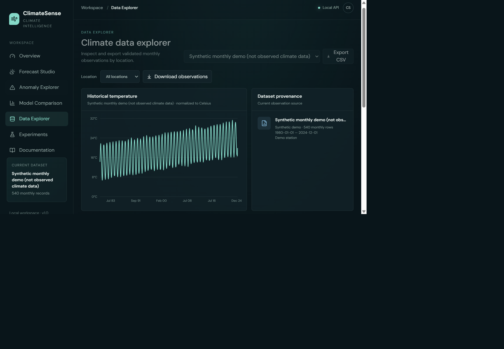

# ClimateSense

ClimateSense is a local climate-data workbench for validating monthly temperature CSVs, exploring observations, comparing chronological forecasts, and reviewing statistical outliers. It combines a Next.js dashboard with a FastAPI/Python analysis service. It does not host data remotely or claim climate attribution.

## Interactive previews

Click any screenshot to jump to the related workflow or methodology. These captures show the clearly labeled synthetic demo; their values are for interface and pipeline testing, not real climate observations.

| Overview · [workflow](#workflow) | Forecast studio · [models](#models-and-interpretation) |
| --- | --- |
| [](#workflow) | [](#models-and-interpretation) |

| Anomaly explorer · [anomaly method](docs/METHODOLOGY.md#anomalies) | Data explorer · [CSV format](#csv-format) |
| --- | --- |
| [](docs/METHODOLOGY.md#anomalies) | [](#csv-format) |

## Local setup

Prerequisites: Python 3.10+ and Node.js 20.9+. Run the API and frontend in separate terminals from the project root.

```powershell
py -m venv .venv
.\.venv\Scripts\Activate.ps1
python -m pip install -r backend/requirements.txt
uvicorn app.main:app --app-dir backend --reload --host 127.0.0.1 --port 8000
```

In a second terminal:

```powershell
npm install
npm run dev
```

Open http://localhost:3000. The interactive API reference is available at http://127.0.0.1:8000/docs. Copy `.env.example` to `.env.local` only when changing the API proxy or allowed browser origins; defaults work for the commands above.

Tests and checks:

```powershell
python -m pytest -c backend/pytest.ini backend/tests -q
npm run lint
npm run typecheck
npm run build
```

## Workflow

1. Import a CSV or load the clearly labeled synthetic demo.
2. Select a dataset/location and inspect normalized monthly observations and summary statistics.
3. Configure the evaluation window, forecast horizon, and optional 12-month seasonal SARIMA; run ARIMA/SARIMA, Random Forest and XGBoost.
4. Compare holdout MAE/RMSE/MAPE, inspect observed-versus-predicted values and forecasts, and review tree-model feature importance.
5. Inspect statistical anomaly flags and download observations or a combined report CSV.

### CSV format

Required: a date field (`date`, `time`, `datetime`, `month`, or `year`) and temperature field (`temperature`, `temp`, `tavg`, `mean temperature`, or `value`). Optional location fields are `location`, `station`, `city`, or `region`. Select the source unit (C/F/K) at upload. Dates are normalized to month starts, invalid rows and duplicates are counted, duplicate month/location values are averaged, and output temperatures are Celsius. A minimum of 24 monthly values is required for analysis.

The demo is generated synthetic data with a fixed random seed; it is not an observation or climate record. Imported data stays in the FastAPI process memory and is cleared when that process stops. Experiment history is likewise in-memory. No database is configured; PostgreSQL/Supabase and SQLAlchemy/Alembic are not implemented in this local build.

## Models and interpretation

- ARIMA uses configurable API order (default `(1,1,1)`). The UI's seasonal option switches this to SARIMA with `(1,0,1,12)` seasonal terms.
- Random Forest and XGBoost use lag 1/2/3/6/12, 3- and 12-month rolling means, and month-of-year sine/cosine features. Tree models recursively generate holdout and future values.
- The last configured number of months is held out chronologically. Feature rows crossing the cutoff are excluded from training. Metrics are computed from actual model outputs; MAE/RMSE are in Celsius. MAPE is omitted only when every actual is zero and can be unstable for near-zero values.
- The anomaly baseline is the mean of up to 10 preceding values from the same calendar month (minimum three prior years), to control for the normal annual cycle. Statistical flags include absolute deviation of at least 2 C, residual `|z| >= 3`, or Isolation Forest. Severity is Moderate at 2 C and High at 4 C from baseline. These thresholds are screening conventions, not climate attribution criteria.

See [architecture](docs/ARCHITECTURE.md), [dataset sources](docs/DATA_SOURCES.md), [methodology](docs/METHODOLOGY.md), and [API notes](docs/API.md). Runtime API schemas are exposed through FastAPI OpenAPI at `/docs`.